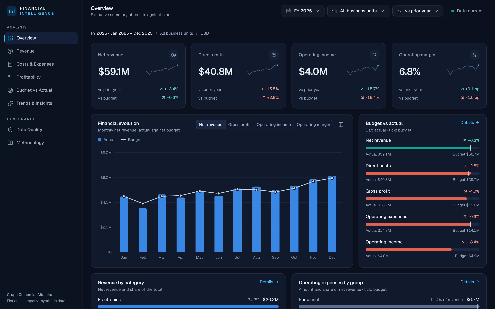
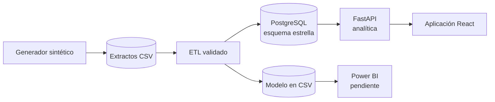
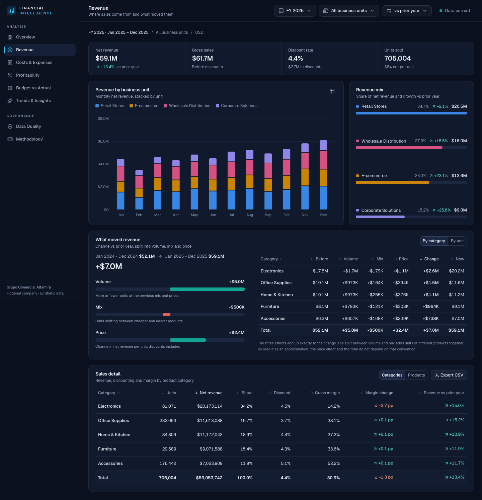
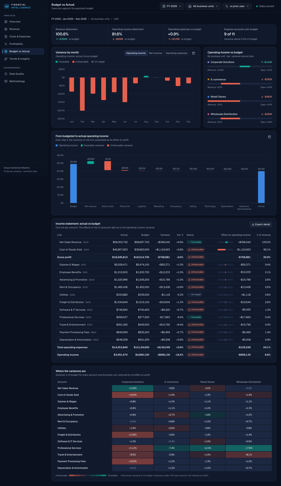
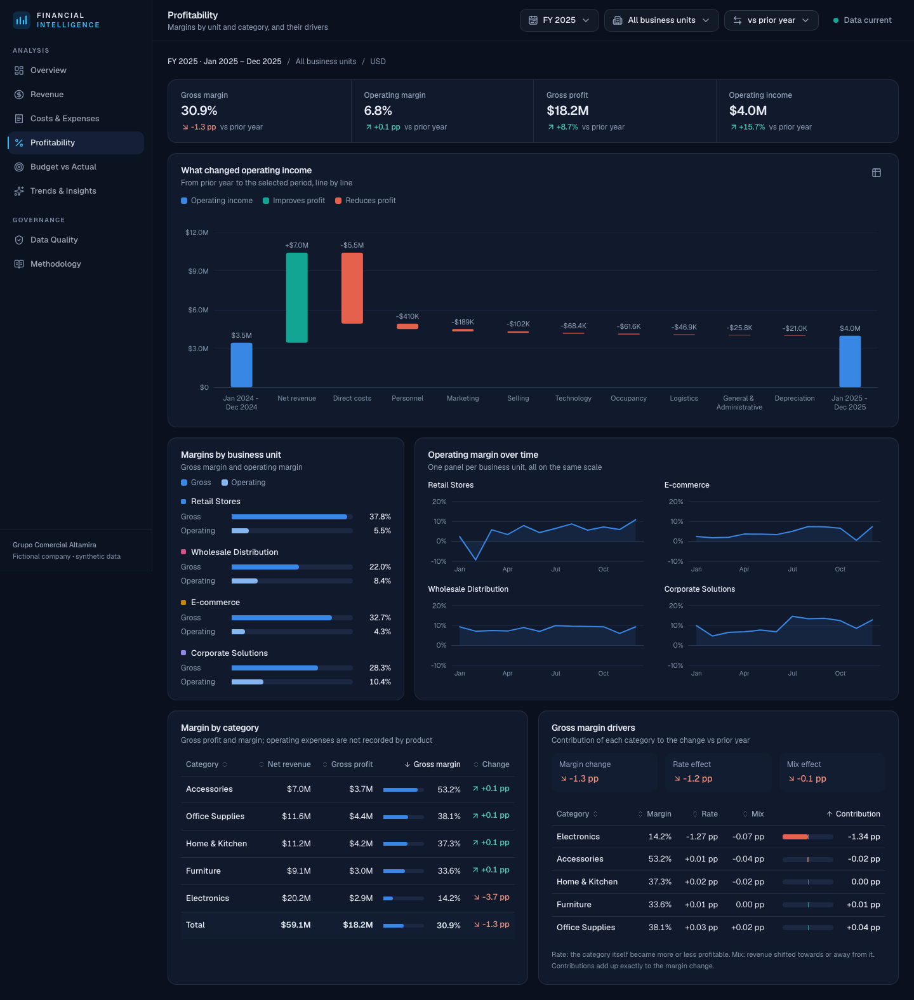
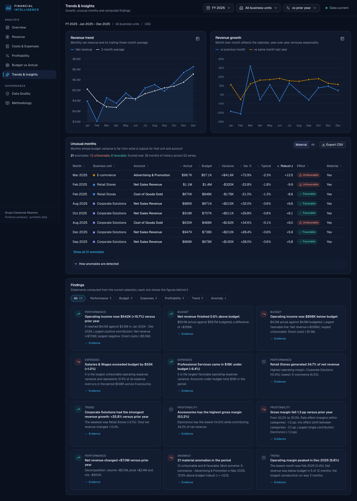
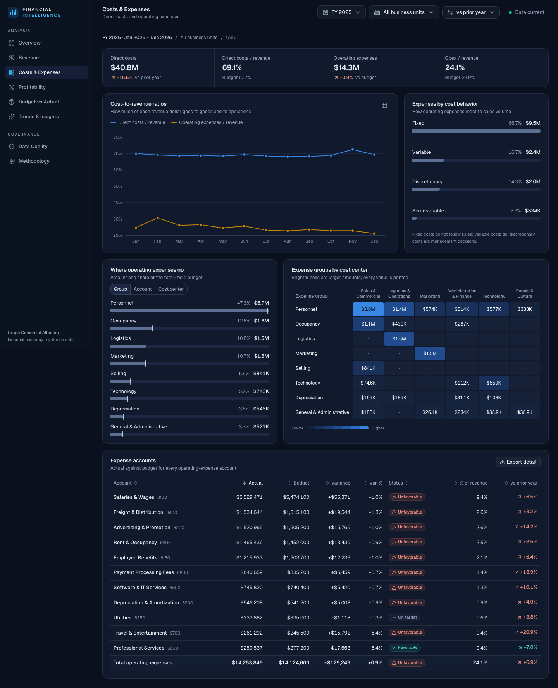
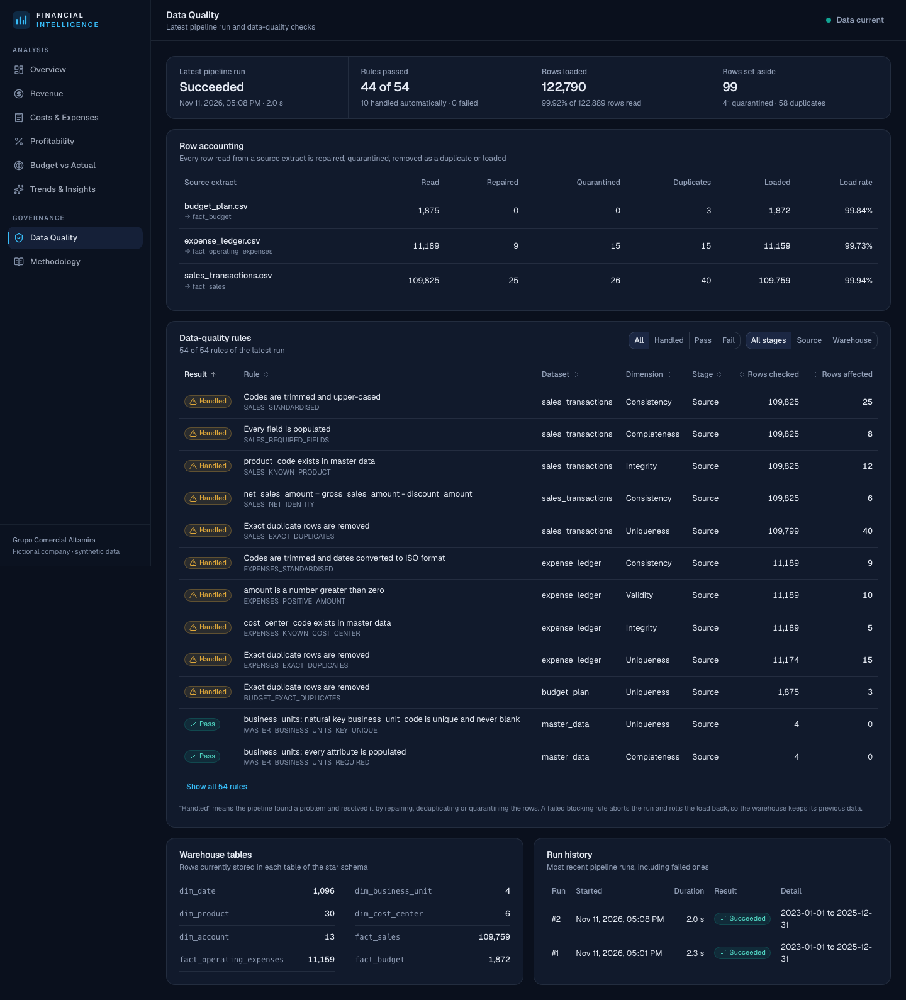

# FINANCIAL INTELLIGENCE

Plataforma analítica de inteligencia financiera y control presupuestal. Convierte
extractos transaccionales de ventas, gastos y presupuesto en indicadores con definición
formal, comparaciones contra el plan y hallazgos calculados, de modo que cada cifra es
reproducible y trazable hasta su origen.

> **Datos sintéticos.** La empresa analizada, Grupo Comercial Altamira, es **ficticia**.
> Todos los datos se generan con un proceso reproducible de semilla fija y no describen ni
> aproximan a ninguna empresa real. Ver [docs/DATA_GENERATION.md](docs/DATA_GENERATION.md).



## Problema

El área financiera de una empresa comercial con cuatro unidades de negocio consolida a
mano ventas, gastos y presupuesto en hojas de cálculo. El resultado son definiciones
inconsistentes de un mismo indicador, cifras que no se pueden rastrear hasta la
transacción y desviaciones que se explican tarde y de forma anecdótica.

Detalle en [docs/BUSINESS_PROBLEM.md](docs/BUSINESS_PROBLEM.md).

## Objetivos

Una vista única que responda, con cifras verificables:

1. ¿Qué unidades generan más ingresos?
2. ¿Qué categorías tienen mejores márgenes?
3. ¿Qué gastos explican las mayores desviaciones?
4. ¿Qué periodos muestran cambios relevantes?
5. ¿Qué diferencias hay entre presupuesto y ejecución?
6. ¿Qué factores explican los cambios de rentabilidad?

No es un sistema contable ni un ERP: no registra transacciones, las analiza.

## Funcionalidades

| Vista | Contenido |
|-------|-----------|
| **Overview** | Indicadores de ingresos, costos, utilidad y margen operativos; evolución frente al presupuesto; desglose de ingresos y gastos; comparación de unidades; hallazgos; tabla mensual con orden, filtro, paginación y exportación |
| **Revenue** | Ingresos por unidad y categoría; descomposición del cambio en precio, volumen y mezcla; detalle por producto |
| **Costs & Expenses** | Razones de costo sobre ingresos; gasto por grupo, cuenta, centro de costo y comportamiento; matriz de grupos por centro de costo |
| **Profitability** | Puente de utilidad operativa; márgenes por unidad y categoría; efectos de mezcla y tasa sobre el margen bruto |
| **Budget vs Actual** | Estado de resultados frente al presupuesto por cuenta; variación mensual y por unidad; mapa de variaciones |
| **Trends & Insights** | Crecimiento intermensual e interanual; meses atípicos con su criterio estadístico; hallazgos con la evidencia de cada uno |
| **Data Quality** | Última ejecución del pipeline, balance de filas y resultado de 54 reglas de calidad |
| **Methodology** | Datos, modelo, catálogo de KPI y métodos, servidos por la API |

Transversales:

- **Filtros globales** de periodo, unidad de negocio y base de comparación que recalculan
  indicadores, gráficos, tablas y hallazgos. Viven en la URL, así que una vista se comparte
  con un enlace.
- **Cada gráfico tiene su tabla** y cada hallazgo muestra las cifras de las que sale.
- **Exportación CSV** con los filtros aplicados.
- **Diseño adaptable**, operable con teclado y auditado con `axe-core`.

## Arquitectura



- **Modelo dimensional (Kimball):** tres hechos con grano declarado (ventas por día, unidad
  y producto; asientos de gasto; presupuesto por mes, unidad y cuenta) y cinco dimensiones
  conformadas.
- **Pipeline:** estandariza, valida fila a fila con cuarentena, deduplica y carga en una
  transacción; concilia al centavo con los totales de control y revierte si algo falla.
- **API de solo lectura:** agrega en SQL y analiza con funciones puras en pandas.
- **Una definición por indicador**, comprobada en la API, en SQL directo y en un recálculo
  independiente.

Detalle en [docs/ARCHITECTURE.md](docs/ARCHITECTURE.md) y
[docs/DATA_MODEL.md](docs/DATA_MODEL.md).

## Modelo de datos

Esquema estrella en PostgreSQL diseñado con los cuatro pasos de Kimball: proceso de negocio,
grano, dimensiones y hechos.

| Tabla de hechos | Grano | Dimensiones |
|-----------------|-------|-------------|
| `fact_sales` | día × unidad de negocio × producto | fecha, unidad, producto |
| `fact_operating_expenses` | asiento contable | fecha, unidad, centro de costo, cuenta |
| `fact_budget` | mes × unidad de negocio × cuenta | fecha (primer día del mes), unidad, cuenta |

Las cinco dimensiones (`dim_date`, `dim_business_unit`, `dim_product`, `dim_cost_center`,
`dim_account`) usan claves sustitutas y conservan la clave natural de origen. El grano de cada
hecho está garantizado por su clave primaria, y la base de datos rechaza filas que violen las
identidades contables (por ejemplo, `venta neta = venta bruta − descuento`). Como la unidad de
negocio y la fecha son las únicas dimensiones que comparten los tres hechos, son también los
únicos filtros globales de la aplicación.

Diagrama, claves y restricciones en [docs/DATA_MODEL.md](docs/DATA_MODEL.md).

## Metodología

El proceso sigue **CRISP-DM**: cada fase tiene un entregable en el repositorio, desde la
definición del problema hasta la evaluación de los métodos
([docs/RESEARCH_DESIGN.md](docs/RESEARCH_DESIGN.md)). La fase de modelado es analítica, no
predictiva: con 36 meses de patrones diseñados, un pronóstico solo reproduciría lo que el
generador programó.

| Método | Qué responde |
|--------|--------------|
| Análisis de variaciones con favorabilidad | Qué cuentas explican la desviación frente al presupuesto o al año anterior |
| Puente de utilidad operativa | Cómo se pasa de la utilidad base a la actual, línea por línea |
| Descomposición precio-volumen-mezcla | Qué parte del cambio de ingresos se debe a precio, a cantidad y a composición |
| Descomposición mezcla-tasa del margen | Si el margen cambia porque los segmentos son menos rentables o porque pesan distinto |
| Detección de atípicos (z robusta, Iglewicz-Hoaglin) | Qué meses de cada serie unidad × cuenta se apartan de su comportamiento típico |

Las descomposiciones son identidades exactas: la suma de las partes es igual al cambio total,
y hay pruebas que lo comprueban con datos aleatorios. Ningún método establece causalidad.
Fórmulas, supuestos y evaluación en
[docs/ANALYSIS_METHODOLOGY.md](docs/ANALYSIS_METHODOLOGY.md).

## Indicadores

Cada indicador tiene una sola definición, servida por la API (`/api/v1/kpi-catalog`), escrita
igual en las medidas DAX y comprobada por tres caminos independientes.

| Indicador | Definición |
|-----------|------------|
| Ingresos netos | Σ venta neta (venta bruta − descuentos) |
| Costos directos | Σ costo de ventas |
| Utilidad bruta · Margen bruto | Ingresos netos − costos directos · utilidad bruta / ingresos netos |
| Gastos operativos | Σ asientos de gasto operativo |
| Utilidad operativa · Margen operativo | Utilidad bruta − gastos operativos · utilidad operativa / ingresos netos |
| Variación presupuestal | Ejecución − presupuesto, en valor y en % de \|presupuesto\| |
| Crecimiento intermensual e interanual | (valor − valor de referencia) / \|valor de referencia\| |
| Tasa de descuento | Σ descuentos / Σ venta bruta |
| Participación en ingresos | Ingresos del segmento / ingresos de la selección |
| Razón de gasto | Gastos operativos / ingresos netos |

Catálogo completo, con unidades, sentido favorable y tratamiento de nulos, en
[docs/KPI_CATALOG.md](docs/KPI_CATALOG.md).

## Resultados

Con los datos sintéticos de referencia, año fiscal 2025 frente a 2024:

- Los ingresos netos crecieron 13,4 % hasta 59,1 M USD; la utilidad operativa, 15,7 % hasta
  4,0 M, pero quedó 18,4 % (0,9 M) por debajo del presupuesto, sobre todo porque el costo de
  ventas superó lo presupuestado en 1,1 M.
- El cambio de ingresos de +7,0 M se descompone en volumen (+5,0 M), precio (+2,4 M) y
  mezcla (−0,5 M).
- El margen bruto cayó 1,3 puntos; 1,27 puntos son efecto tasa en electrónica, cuyo margen
  pasó de 17,9 % a 14,2 %.
- El detector de atípicos marca 21 celdas materiales en el año. Evaluado contra los nueve
  escenarios inyectados, tiene una precisión de 98 % entre las señales materiales (86 % si
  solo se cuentan como aciertos las celdas afectadas directamente). Repetida la evaluación
  con 19 semillas que no se usaron para ajustarlo, la precisión media se mantiene en 98 %,
  pero detecta los nueve escenarios en 14 de las 19 realizaciones y ocho en las demás. **No
  detecta un alza de costos diluida a lo largo del año** en ninguna de ellas.

Son resultados sobre datos diseñados: muestran que los métodos encuentran los patrones que se
inyectaron, no que funcionen igual con datos reales.

## Tecnologías

| Área | Tecnologías |
|------|-------------|
| Datos | PostgreSQL 16, SQL, pandas, NumPy, Alembic |
| Backend | Python 3.12, FastAPI, Pydantic, SQLAlchemy |
| Frontend | React 19, TypeScript, Vite, Tailwind CSS, shadcn/ui, Apache ECharts, TanStack Query, React Router, Lucide |
| BI | Power BI (Power Query, DAX) sobre el mismo modelo |
| Calidad | Pytest, Ruff, mypy, Vitest, React Testing Library, Playwright, axe-core, oxlint |
| Infraestructura | Make, Docker Compose, GitHub Actions |

## Instalación

Requisitos: **Python 3.12**, **Node.js 22 o superior** (desarrollado con la versión 26) y
**PostgreSQL 16**. En macOS con
Homebrew:

```bash
brew install python@3.12 node postgresql@16
```

Preparación (unos minutos):

```bash
make setup       # entorno virtual, dependencias de Python y de Node; crea .env
make db-init     # clúster PostgreSQL local del proyecto en .local/pgdata, puerto 5433
make pipeline    # genera los datos, crea el esquema y carga el almacén
```

`make setup` crea `.env` a partir de `.env.example`. Conviene cambiar
`POSTGRES_PASSWORD` **antes** de `make db-init`; la base de datos solo escucha en
`127.0.0.1`.

La base de datos de desarrollo es un clúster propio del proyecto: no instala ningún
servicio del sistema ni toca otras bases de datos del equipo.

## Ejecución

En dos terminales:

```bash
make api         # API en http://127.0.0.1:8000  (documentación en /api/v1/docs)
make web         # aplicación en http://localhost:5173
```

Otros comandos:

```bash
make help        # lista completa
make db-stop     # detiene PostgreSQL
make validate    # consultas SQL de validación independientes
make evaluate    # evalúa el detector de atípicos contra los escenarios
make evaluate-seeds  # repite la evaluación con 20 semillas
make powerbi-data
```

### Con Docker Compose

Alternativa que no requiere instalar Python, Node ni PostgreSQL: cuatro servicios
(PostgreSQL, un pipeline que migra, genera y carga, la API y la web servida por nginx).

```bash
cp .env.example .env     # y cambia POSTGRES_PASSWORD
docker compose up --build
open http://localhost:8080
```

Verificado el 2026-11-12 con Docker Desktop 29 en macOS: las imágenes se construyen, el
pipeline carga el almacén, la API queda sana y la aplicación responde en el puerto 8080
con las mismas cifras que la instalación nativa. Las 43 pruebas de extremo a extremo
también pasan contra esta pila (`make e2e-docker`). Al volver a arrancar sobre el mismo
volumen, el pipeline recarga el almacén y conserva el historial de ejecuciones.

## Pruebas

```bash
make ci          # todas las verificaciones, igual que el flujo de CI
```

Última ejecución completa (2026-11-12):

| Verificación | Resultado |
|--------------|-----------|
| Pytest (unitarias e integración contra PostgreSQL) | 257 de 257 · cobertura 95 % |
| Consultas SQL de validación | 16 de 16 sin violaciones |
| Ruff · mypy estricto | Sin incidencias |
| Vitest y Testing Library | 73 de 73 |
| Playwright contra la aplicación real | 43 de 43 |
| Playwright contra la pila de Docker Compose (nginx en 8080) | 43 de 43 |
| oxlint · TypeScript estricto · compilación | Sin incidencias |

Cada indicador se triangula por tres caminos que no comparten código. Estrategia y
detalle en [docs/TESTING.md](docs/TESTING.md).

Las pruebas de navegador necesitan una vez `npx --prefix frontend playwright install
chromium`.

## Datos sintéticos

| | |
|---|---|
| Empresa | Grupo Comercial Altamira (ficticia) |
| Periodo | Enero de 2023 a diciembre de 2025 |
| Moneda | USD |
| Volumen | 109 759 líneas de venta, 11 159 asientos de gasto, 1 872 líneas de presupuesto |
| Semilla | `20230101` |

El generador separa un plan determinista, del que sale el presupuesto, de una ejecución
alterada por nueve escenarios documentados y por ruido. Así toda desviación tiene un origen
identificable y los métodos se pueden evaluar contra una verdad conocida. También inyecta
defectos de calidad controlados para que el pipeline demuestre que los trata.

Los CSV no se versionan: se regeneran de forma idéntica. Una prueba comprueba que los
datos regenerados coinciden con las huellas SHA-256 del manifiesto versionado.

## Capturas

Todas son de la aplicación en ejecución y se regeneran con `make screenshots`.

| | |
|---|---|
|  |  |
| Revenue | Budget vs Actual |
|  |  |
| Profitability | Trends & Insights |
|  |  |
| Costs & Expenses | Data Quality |

Más capturas, incluidas las de teléfono y la vista filtrada, en
[docs/UI_DESIGN.md](docs/UI_DESIGN.md).

## Verificación

Todas las cifras de este README se reprodujeron desde cero en un entorno limpio (Linux, en
lugar del macOS de desarrollo): datos regenerados idénticos byte a byte al manifiesto, todas
las suites de pruebas y un recálculo de los resultados con código escrito aparte. El detalle,
incluido lo que no se pudo verificar, está en [AUDIT.md](AUDIT.md).

## Estado y limitaciones

| Componente | Estado |
|------------|--------|
| Datos, modelo, pipeline, API, aplicación web, pruebas | Completado y verificado |
| Docker Compose | Completado y verificado (macOS, Docker Desktop 29) |
| Insumos de Power BI (consultas M, medidas DAX, tema, valores esperados) | Implementado, sin verificar en Power BI |
| Informe Power BI (`.pbix`) | **Pendiente**: requiere Power BI Desktop, que no existe para macOS |
| GitHub Actions | Implementado, sin verificar (repositorio sin publicar) |

Lo más importante que conviene saber:

- Los datos son sintéticos y sus patrones, diseñados: los resultados muestran que los
  métodos funcionan sobre esos patrones, no sobre datos reales.
- El análisis llega hasta la utilidad operativa y esta solo existe por periodo y unidad de
  negocio.
- Las descomposiciones y los atípicos describen dónde está una variación; no establecen su
  causa.
- No hay autenticación: la aplicación está pensada para ejecutarse en local.

La lista completa está en [docs/LIMITATIONS.md](docs/LIMITATIONS.md).

## Trabajo futuro

- Construir el informe Power BI (`.pbix`) en Windows y validarlo contra los 116 valores
  esperados de `powerbi/validation/expected_values.csv`.
- Presupuesto flexible para separar, en los costos variables, el efecto volumen del efecto
  tarifa.
- Evaluar el detector con escenarios y modelos de ruido distintos de los del generador, y
  complementarlo con un método para efectos prolongados y diluidos.
- Carga incremental y dimensiones de cambio lento (tipo 2) para volúmenes y datos maestros
  reales.
- Autenticación y caché en la API antes de exponerla fuera de un equipo local.

## Documentación

| Tema | Documento |
|------|-----------|
| Problema y preguntas de negocio | [BUSINESS_PROBLEM.md](docs/BUSINESS_PROBLEM.md) |
| Metodología (CRISP-DM, Kimball) | [RESEARCH_DESIGN.md](docs/RESEARCH_DESIGN.md) |
| Generación de datos | [DATA_GENERATION.md](docs/DATA_GENERATION.md) |
| Diccionario de datos | [DATA_DICTIONARY.md](docs/DATA_DICTIONARY.md) |
| Modelo dimensional | [DATA_MODEL.md](docs/DATA_MODEL.md) |
| Catálogo de KPI | [KPI_CATALOG.md](docs/KPI_CATALOG.md) |
| Pipeline ETL | [ETL_PIPELINE.md](docs/ETL_PIPELINE.md) |
| Calidad de datos | [DATA_QUALITY.md](docs/DATA_QUALITY.md) |
| Arquitectura | [ARCHITECTURE.md](docs/ARCHITECTURE.md) |
| API | [API_REFERENCE.md](docs/API_REFERENCE.md) |
| Métodos analíticos y su evaluación | [ANALYSIS_METHODOLOGY.md](docs/ANALYSIS_METHODOLOGY.md) |
| Power BI | [POWER_BI.md](docs/POWER_BI.md) |
| Diseño de la interfaz | [UI_DESIGN.md](docs/UI_DESIGN.md) |
| Pruebas | [TESTING.md](docs/TESTING.md) |
| Limitaciones | [LIMITATIONS.md](docs/LIMITATIONS.md) |
| Decisiones de diseño | [DECISIONS.md](docs/DECISIONS.md) |
| Verificación de reproducibilidad | [AUDIT.md](AUDIT.md) |
| Historial de cambios | [CHANGELOG.md](CHANGELOG.md) |

## Licencia

[MIT](LICENSE).
