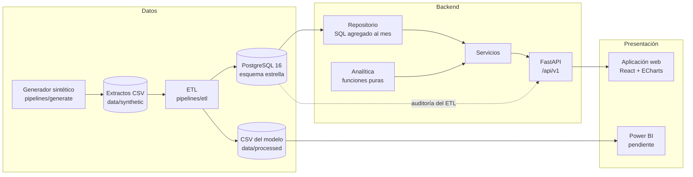
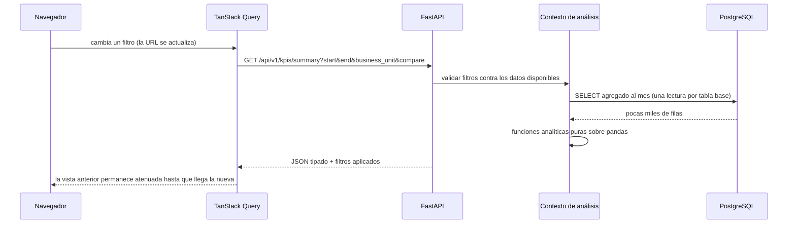
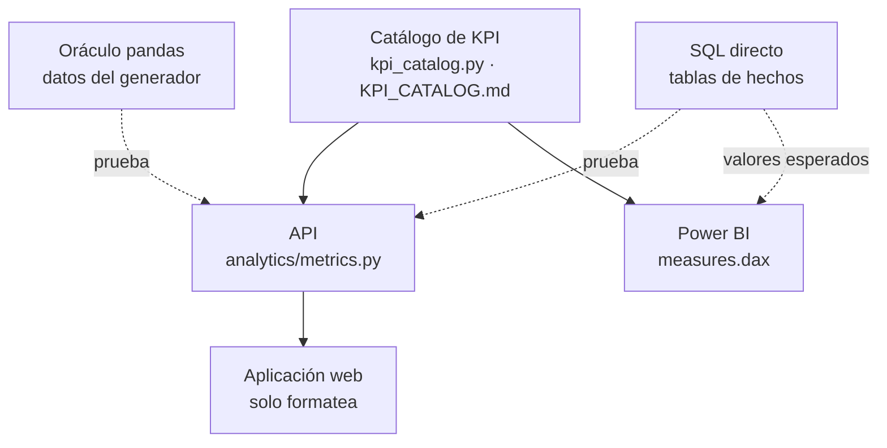

# Arquitectura

FINANCIAL INTELLIGENCE es una plataforma analítica de tres capas: un pipeline de datos que
construye un almacén dimensional, una API de solo lectura que calcula los indicadores, y
una aplicación web que los presenta. Power BI consume el mismo modelo.

## 1. Vista general



| Capa | Tecnología | Responsabilidad |
|------|------------|-----------------|
| Generación | Python, NumPy, pandas | Extractos sintéticos reproducibles con defectos controlados |
| ETL | Python, pandas, `COPY` de PostgreSQL | Validar, modelar, cargar y conciliar |
| Almacén | PostgreSQL 16, Alembic | Esquema estrella con restricciones; auditoría de ejecuciones |
| API | FastAPI, Pydantic, SQLAlchemy | Indicadores, análisis y exportaciones tipados |
| Web | React, TypeScript, Vite, Tailwind, shadcn/ui, ECharts, TanStack Query | Exploración interactiva |
| BI | Power BI (M, DAX) | Mismo modelo; informe pendiente |

## 2. Flujo de una solicitud



- **Agregación en SQL, análisis en pandas.** Ninguna consulta trae filas diarias a la
  aplicación. El repositorio devuelve tres tablas base ya agregadas al mes: por cuenta
  (ejecución y presupuesto), por producto (ventas) y por centro de costo (gastos).
- **Un contexto por solicitud.** Los filtros se validan una vez y las tablas se cargan de
  forma perezosa y se comparten entre todos los cálculos de la respuesta, de modo que sus
  cifras son coherentes entre sí.
- **El historial completo siempre está disponible.** El filtro de periodo se aplica en
  memoria: el crecimiento interanual y la detección de atípicos necesitan meses fuera del
  periodo seleccionado.

## 3. Backend

```
backend/app/
  main.py              aplicación, CORS, manejo de errores
  core/
    config.py          configuración desde variables de entorno
    kpi_catalog.py     definiciones formales de los KPI
  db/
    models.py          modelo dimensional y tablas de auditoría (SQLAlchemy)
    session.py         motor y sesiones
    validation.py      lector de consultas SQL con nombre
  repositories/
    warehouse.py       SQL de solo lectura
  analytics/           funciones puras, sin acceso a la base de datos
    metrics.py         fórmulas, favorabilidad, estado de resultados
    periods.py         periodos y periodos de comparación
    contribution.py    puente, precio-volumen-mezcla, mezcla y tasa
    anomalies.py       puntuación z robusta
  services/            orquestan repositorio y analítica y construyen las respuestas
    context.py         filtros validados + tablas compartidas
    performance.py     KPI, series, tabla mensual
    budget.py · profitability.py · expenses.py · analysis.py · insights.py
    quality.py · exports.py · formatting.py
  api/
    deps.py            dependencias comunes (filtros globales)
    routers/           endpoints
  schemas.py           respuestas tipadas (Pydantic)
```

**Dirección de las dependencias:** `api → services → {analytics, repositories} → db`. La
capa analítica no importa nada de las demás, lo que permite probarla sin base de datos y
reutilizarla en el script de evaluación.

### Decisiones de diseño

| Decisión | Motivo |
|----------|--------|
| API de solo lectura, solo `GET` | La plataforma analiza datos; no los registra |
| Funciones analíticas puras | Se prueban con tablas pequeñas y con datos aleatorios |
| Sin ORM en las consultas analíticas | SQL explícito y legible; el ORM se usa para definir el esquema y las migraciones |
| Cada consulta lee un solo hecho (o la vista de comparación) | Imposible multiplicar filas al combinar hechos |
| Sin caché | Las consultas base tardan entre 12 y 22 ms; una caché añadiría estado e invalidación |
| Errores uniformes | 422 con el motivo y los valores válidos; 503 sin detalles de conexión |

## 4. Datos

- **Modelo:** tres hechos con grano declarado y cinco dimensiones conformadas
  ([DATA_MODEL.md](DATA_MODEL.md)).
- **Carga:** recarga completa en una transacción, con verificaciones posteriores; un fallo
  bloqueante revierte la carga ([ETL_PIPELINE.md](ETL_PIPELINE.md)).
- **Auditoría:** cada ejecución registra el balance de filas y el resultado de 54 reglas
  ([DATA_QUALITY.md](DATA_QUALITY.md)).

## 5. Frontend

```
frontend/src/
  lib/           formato · cliente de API · filtros en la URL · consultas · tema de gráficos
  components/    ui (shadcn) · common · charts · layout
  pages/         ocho vistas, cargadas bajo demanda
```

| Decisión | Motivo |
|----------|--------|
| Tipos generados desde OpenAPI | El cliente no puede divergir del contrato del servidor |
| Filtros en la URL | Vistas compartibles; el estado sobrevive a la navegación y a la recarga |
| TanStack Query con datos previos | Sin parpadeo al cambiar filtros; reintentos solo ante fallos transitorios |
| Ningún cálculo financiero en el cliente | Una sola implementación de cada indicador, en el backend |
| Vistas en fragmentos separados | La biblioteca de gráficos se descarga solo donde se usa |
| Constructores de opciones de gráficos como funciones puras | Se prueban sin navegador |

El sistema visual está en [UI_DESIGN.md](UI_DESIGN.md).

## 6. Una definición, tres consumidores

Cada indicador se define una vez y se comprueba en cada consumidor:



## 7. Entornos de ejecución

| Entorno | Estado |
|---------|--------|
| Nativo: PostgreSQL local del proyecto, `uvicorn`, Vite | **Verificado**; es la ruta descrita en el README |
| CI local: `make ci` | **Verificado** |
| Docker Compose | Implementado, **no verificado** (sin Docker en el equipo de desarrollo) |
| GitHub Actions | Implementado, **no verificado** (repositorio sin publicar) |

### Configuración y secretos

- Toda la configuración llega por variables de entorno; `.env` no se versiona y
  `.env.example` solo contiene valores de ejemplo.
- La contraseña de la base de datos se maneja como `SecretStr` y nunca se registra.
- PostgreSQL local escucha solo en `127.0.0.1`, con autenticación `scram-sha-256`.
- La API no tiene autenticación: está pensada para ejecutarse en local
  ([LIMITATIONS.md](LIMITATIONS.md)).

## 8. Estructura del repositorio

```
backend/        API y capa analítica
pipelines/      generate (datos sintéticos) · etl · evaluation
database/       migrations (Alembic) · sql (consultas de validación)
frontend/       aplicación web y pruebas de extremo a extremo
powerbi/        consultas M, medidas DAX, tema, valores esperados
data/           synthetic (extractos) · processed (modelo estrella en CSV)
tests/          generate · etl · analytics · api · integration
docs/           documentación, capturas, evaluación
scripts/        base de datos local, CI local, exportaciones
docker/         Dockerfiles y configuración de nginx
```
