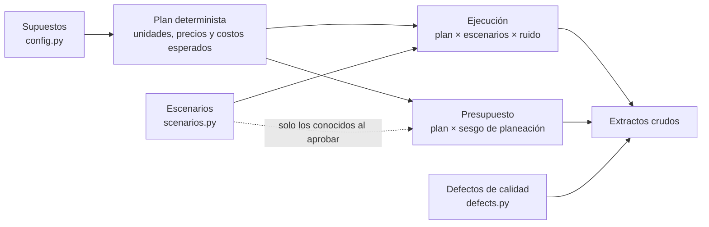

# Generación de datos sintéticos

> **Los datos de este proyecto son sintéticos.** Grupo Comercial Altamira no existe. Las
> cifras salen de un modelo con supuestos explícitos y una semilla fija; no describen ni
> aproximan a ninguna empresa real y no deben citarse como referencia de mercado.

## 1. Ficha del conjunto de datos

| Atributo | Valor |
|----------|-------|
| Empresa | Grupo Comercial Altamira (ficticia) |
| Periodo | 2023-01-01 a 2025-12-31 (36 meses, 3 años fiscales calendario) |
| Moneda | USD |
| Semilla | `20230101` |
| Versión del generador | `1.0.0` |
| Código | [`pipelines/generate/`](../pipelines/generate/) |
| Comando | `make data` (equivale a `python -m pipelines.generate`) |
| Salida | `data/synthetic/` |

### Archivos generados

| Archivo | Grano | Filas crudas | Filas válidas |
|---------|-------|-------------:|--------------:|
| `sales_transactions.csv` | fecha × unidad de negocio × producto | 109 825 | 109 759 |
| `expense_ledger.csv` | asiento de gasto | 11 189 | 11 159 |
| `budget_plan.csv` | mes × unidad de negocio × cuenta | 1 875 | 1 872 |
| `products.csv` | producto | 30 | 30 |
| `business_units.csv` | unidad de negocio | 4 | 4 |
| `cost_centers.csv` | centro de costo | 6 | 6 |
| `chart_of_accounts.csv` | cuenta | 13 | 13 |
| `scenarios.json` | escenario inyectado (verdad de fondo) | — | — |
| `MANIFEST.json` | huellas SHA-256, conteos y totales de control | — | — |

La diferencia entre filas crudas y válidas corresponde a los defectos de calidad inyectados
a propósito (sección 6).

Los CSV no se versionan: se regeneran de forma idéntica con la semilla. `MANIFEST.json` y
`scenarios.json` sí están bajo control de versiones, y una prueba automatizada comprueba que
los archivos regenerados producen exactamente las huellas del manifiesto.

## 2. Reproducibilidad

- Un único `numpy.random.SeedSequence(semilla)` se divide en cuatro flujos independientes
  (costos de producto, ventas, gastos, defectos). Cambiar un componente no altera los demás.
- Los importes se calculan en centavos enteros y se escriben con dos decimales fijos.
- El manifiesto no contiene marcas de tiempo.
- Las versiones exactas de las dependencias están en `requirements.lock`. Un cambio de
  versión mayor de NumPy podría alterar los flujos aleatorios; en ese caso la prueba de
  reproducibilidad falla y el manifiesto debe regenerarse de forma deliberada.

## 3. Estructura del modelo

El generador separa dos capas:



- El **plan** es lo que la empresa espera vender y gastar sin sorpresas.
- El **presupuesto** es ese plan visto por quien planea: metas de ingreso con un sesgo
  optimista, gastos con un ahorro asumido y cifras redondeadas a centenas.
- La **ejecución** es el plan alterado por escenarios documentados y por ruido aleatorio.

Así, toda desviación presupuestal tiene una de tres fuentes identificables: sesgo de
planeación, un escenario o ruido.

## 4. Reglas de generación

### 4.1 Ventas

Para cada día *d*, unidad *b* y producto *p*:

```
ingreso_esperado = (ingreso_base_anual[b] / 365)
                 × crecimiento[b]^((d − 182) / 365)
                 × perfil_semanal[b, día de la semana]
                 × estacionalidad[categoría(p), mes]
                 × mezcla[b, categoría(p)] × peso[p]

unidades_esperadas = ingreso_esperado / (precio_plan × (1 − descuento_esperado))
unidades           = Poisson(unidades_esperadas × efecto_escenario × ruido)

venta_bruta = unidades × precio_unitario
descuento   = venta_bruta × tasa_de_descuento
venta_neta  = venta_bruta − descuento
costo       = unidades × costo_unitario
```

Solo se escribe una fila cuando `unidades > 0`, por lo que los productos de baja rotación
no aparecen todos los días.

**Supuestos por unidad de negocio**

| Unidad | Ingreso base 2023 | Crecimiento anual | Precio / lista | Descuento base | Opera fines de semana |
|--------|------------------:|------------------:|---------------:|---------------:|:---------------------:|
| Retail Stores | 19,5 M | 3 % | 100 % | 3,5 % | Sí (pico el sábado) |
| E-commerce | 9,0 M | 21 % | 97 % | 6,0 % | Sí |
| Wholesale Distribution | 14,0 M | 6 % | 80 % | 2,0 % | Sábado reducido |
| Corporate Solutions | 6,5 M | 9 % | 88 % | 4,0 % | No |

**Supuestos por categoría**

| Categoría | Margen estándar a precio de lista | Meses de mayor demanda |
|-----------|----------------------------------:|------------------------|
| Electronics | 28 % | Noviembre, diciembre |
| Office Supplies | 46 % | Enero, febrero, agosto |
| Furniture | 40 % | Junio, julio |
| Home & Kitchen | 44 % | Mayo, noviembre, diciembre |
| Accessories | 56 % | Noviembre, diciembre |

El margen de cada producto se desvía hasta ±4 puntos del estándar de su categoría.

**Otros supuestos**

- Precios de lista: +3,0 % en enero de 2024 y +3,5 % en enero de 2025.
- Costos de proveedor: +3,2 % en enero de 2024 y +3,0 % en enero de 2025.
- Descuento promocional adicional: enero (+3 puntos en Retail y E-commerce) y noviembre
  (+6 puntos en Retail y E-commerce, +2 en las demás).
- Ruido de demanda (multiplicadores log-normales de media 1): 12 % por fila, 6 % común a la
  unidad en el día y 3,5 % común a la unidad-categoría en el mes.

### 4.2 Gastos operativos

Cada cuenta sigue una regla acorde con su comportamiento:

| Cuenta | Comportamiento | Regla del importe mensual |
|--------|----------------|---------------------------|
| 6100 Salaries & Wages | Fijo | Base anual / 12 × aumento anual (4,0 % y 4,5 %) × crecimiento de planta |
| 6150 Employee Benefits | Fijo | 22 % de los salarios |
| 6200 Advertising & Promotion | Discrecional | Tasa × ingreso planeado × calendario de campañas |
| 6300 Rent & Occupancy | Fijo | Base anual / 12 con incremento anual de 3,5 % |
| 6350 Utilities | Semivariable | Base anual / 12 × calendario × inflación de 4 % |
| 6400 Freight & Distribution | Variable | Tasa × ingreso neto **real** del mes |
| 6500 Software & IT Services | Fijo | Base anual / 12 con incremento anual de 5 % |
| 6600 Professional Services | Discrecional | Base anual / 12 con alta dispersión (σ = 30 %) |
| 6700 Travel & Entertainment | Discrecional | Base anual / 12 × calendario de viajes |
| 6800 Payment Processing Fees | Variable | Tasa × ingreso neto **real** del mes |
| 6900 Depreciation & Amortization | Fijo | Base anual / 12 con escalón anual de 4 % |

El importe mensual de cada cuenta se reparte entre centros de costo con proporciones fijas
y luego en asientos: nómina en dos corridas (día 15 y fin de mes), arriendo el día 1,
software el día 5, depreciación a fin de mes y el resto en 2 a 6 asientos en días
aleatorios. El reparto se hace en centavos enteros, de modo que los asientos suman
exactamente el importe mensual.

### 4.3 Presupuesto

Para cada mes, unidad y cuenta:

- **Ingresos y costo de ventas:** plan determinista × factor de exigencia de la unidad
  (entre 1,015 y 1,030).
- **Gastos operativos:** las mismas reglas de la sección 4.2 aplicadas al ingreso
  presupuestado, × 0,99 (ahorro asumido).
- Solo incluye los efectos conocidos al aprobar el presupuesto de cada año.
- Cada línea se redondea a la centena.

## 5. Escenarios introducidos

Los escenarios son la verdad de fondo contra la que se evalúa el análisis. Se definen en
[`scenarios.py`](../pipelines/generate/scenarios.py) y se exportan a `scenarios.json`.

| ID | Escenario | Unidad | Periodo | Efecto | Sentido |
|----|-----------|--------|---------|--------|---------|
| S1 | Pérdida de un distribuidor clave | WHS | abr–jun 2024 (cola hasta ago) | Demanda −26 % (−8 % en la cola) | Desfavorable |
| S2 | Campaña de adquisición no presupuestada | ECM | mar–abr 2025 | Publicidad +85 % y +35 %; demanda +14 % y +10 % | Mixto |
| S3 | Remodelación de la tienda principal | RET | feb 2025 | Demanda −20 % | Desfavorable |
| S4 | Nuevo contrato de suministro | COR | jul–dic 2025 | Demanda +28 % | Favorable |
| S5 | Alza de costos de proveedores de electrónica | Todas | 2025 | Costo unitario +7 %; precio de lista +4 % desde julio | Desfavorable |
| S6 | Alza de tarifas de flete | Todas | ago–nov 2024 | Fletes +38 % | Desfavorable |
| S7 | Acuerdo legal extraordinario | RET | sep 2023 | +185 000 USD en servicios profesionales | Desfavorable |
| S8 | Migración de plataforma de comercio | ECM | desde mar 2024 | +22 000 USD/mes en software; presupuestado desde 2025 | Desfavorable |
| S9 | Congelación de viajes | WHS, COR | oct–dic 2024 | Viajes −60 % | Favorable |

Cada escenario declara además su **huella esperada** sobre la desviación presupuestal:
celdas (cuenta, unidad, mes) *primarias*, donde el efecto es directo, y *derivadas*, donde
es consecuencia mecánica (por ejemplo, una caída de demanda reduce también el costo de
ventas, los fletes y las comisiones de pago).

La capa analítica **no lee** esta definición. Los hallazgos de la aplicación se calculan
solo con los datos cargados; `scenarios.json` se usa únicamente en el script de evaluación.

## 6. Defectos de calidad inyectados

Los extractos reales nunca llegan limpios. Para que el pipeline demuestre que estandariza,
deduplica y aparta registros inválidos, el generador inyecta defectos controlados:

| Extracto | Defecto | Filas | Tratamiento esperado en el ETL |
|----------|---------|------:|--------------------------------|
| Ventas | Fila duplicada exacta | 40 | Deduplicar |
| Ventas | Código de unidad con espacios o minúsculas | 25 | Estandarizar (recuperable) |
| Ventas | Código de producto inexistente | 12 | Rechazar |
| Ventas | Unidades vendidas vacías | 8 | Rechazar |
| Ventas | Venta neta ≠ bruta − descuento | 6 | Rechazar |
| Gastos | Asiento duplicado exacto | 15 | Deduplicar |
| Gastos | Fecha en formato `DD/MM/AAAA` | 9 | Estandarizar (recuperable) |
| Gastos | Importe cero o negativo | 10 | Rechazar |
| Gastos | Centro de costo inexistente | 5 | Rechazar |
| Presupuesto | Línea duplicada exacta | 3 | Deduplicar |

Los defectos son **aditivos o recuperables**: las filas inválidas son filas adicionales y
los defectos de formato se pueden deshacer. El conjunto válido se recupera por completo y
sus totales, registrados como totales de control en el manifiesto, deben coincidir con lo
que el ETL carga en la base de datos.

## 7. Limitaciones del conjunto de datos

- **Patrones diseñados.** Estacionalidad, crecimiento y escenarios los definió el autor. Que
  un análisis los encuentre demuestra que el método funciona sobre estos patrones, no que
  funcionaría sobre datos reales.
- **Sin elasticidad de precio.** Un alza de precio no reduce las unidades vendidas.
- **Sin efectos cruzados.** La publicidad no impulsa la demanda salvo en el escenario S2,
  donde ambos efectos se fijan por separado; las unidades de negocio no se canibalizan.
- **Ruido independiente.** No hay autocorrelación entre meses ni choques comunes a toda la
  empresa, más allá de los escenarios.
- **Ventas agregadas por día.** El grano es día × unidad × producto; no existen facturas,
  clientes ni devoluciones.
- **Sin partidas no operativas.** No hay intereses, impuestos, balance ni flujo de caja.
- **Una sola versión de presupuesto.** No hay pronósticos revisados ni reprevisiones.
