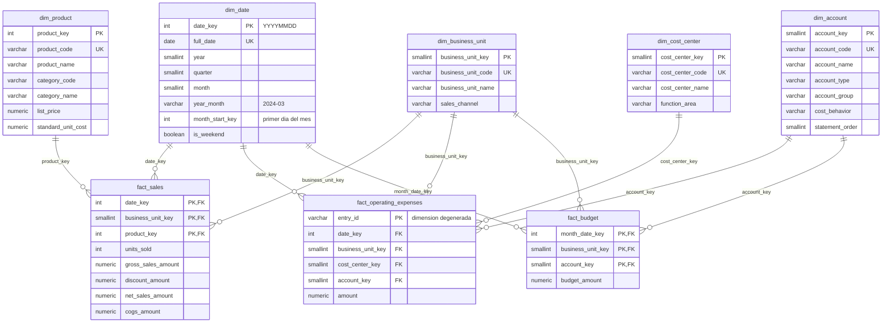

# Modelo de datos

El almacén sigue un **esquema estrella** (Kimball) en PostgreSQL 16: tres tablas de hechos
que comparten dimensiones conformadas. Las tablas se definen en
[`backend/app/db/models.py`](../backend/app/db/models.py) y se crean con las migraciones de
Alembic en [`database/migrations/`](../database/migrations/).

## 1. Diagrama entidad-relación

## 2. Grano de las tablas de hechos

| Tabla | Grano declarado | Clave primaria | Filas |
|-------|-----------------|----------------|------:|
| `fact_sales` | Una fila por **día × unidad de negocio × producto** con ventas | (`date_key`, `business_unit_key`, `product_key`) | 109 759 |
| `fact_operating_expenses` | Una fila por **asiento de gasto** del libro | `entry_id` | 11 159 |
| `fact_budget` | Una fila por **mes × unidad de negocio × cuenta** | (`month_date_key`, `business_unit_key`, `account_key`) | 1 872 |

Todas las medidas son **aditivas** en todas las dimensiones. Los márgenes y porcentajes no
se almacenan: se calculan como razón de sumas en la capa analítica, nunca como promedio de
porcentajes.

### Cómo se evita la doble contabilización

Cada concepto financiero vive en una sola tabla:

| Concepto | Única fuente |
|----------|--------------|
| Ingresos netos | `fact_sales.net_sales_amount` |
| Costos directos | `fact_sales.cogs_amount` |
| Gastos operativos | `fact_operating_expenses.amount` |
| Presupuesto de cualquier cuenta | `fact_budget.budget_amount` |

- El costo de ventas no existe en el libro de gastos, y los gastos operativos no existen en
  ventas. Una restricción de calidad verifica que `fact_operating_expenses` solo use cuentas
  de tipo `OPERATING_EXPENSE`.
- `fact_budget` nunca se suma con los hechos de ejecución; solo se compara.
- Los hechos nunca se unen entre sí fila a fila. Se agregan primero al grano común y después
  se combinan (*drill-across*), lo que impide la multiplicación de filas.

## 3. Dimensiones conformadas

| Dimensión | Filas | Usada por | Notas |
|-----------|------:|-----------|-------|
| `dim_date` | 1 096 | Los tres hechos | Clave inteligente `YYYYMMDD`. El presupuesto, de grano mensual, referencia el primer día del mes |
| `dim_business_unit` | 4 | Los tres hechos | |
| `dim_product` | 30 | `fact_sales` | Incluye la jerarquía categoría → producto ([D-005](DECISIONS.md)) |
| `dim_cost_center` | 6 | `fact_operating_expenses` | |
| `dim_account` | 13 | `fact_operating_expenses`, `fact_budget` | Plan de cuentas con tipo, grupo y comportamiento del costo |

Las dimensiones usan **claves sustitutas** generadas por la base de datos (`IDENTITY`) y
conservan la **clave natural** del sistema de origen con una restricción `UNIQUE`. La
excepción es `dim_date`, cuya clave `YYYYMMDD` es estable por definición.

**Cambios en las dimensiones.** El modelo no gestiona historia de atributos: las dimensiones
se tratan como **tipo 1** (se sobrescriben en cada carga completa) y no hay dimensiones de
cambio lento de tipo 2. Es suficiente porque los datos maestros sintéticos no cambian en el
periodo; con datos reales, un cambio de categoría o de precio de lista reescribiría la
historia y habría que versionar `dim_product`. Ver [LIMITATIONS.md](LIMITATIONS.md).

### Presupuesto mensual sobre una dimensión diaria

`fact_budget` tiene grano mensual y `dim_date` grano diario. En lugar de crear una segunda
dimensión de meses, el presupuesto referencia el **primer día del mes**
(`month_date_key`), y una restricción `CHECK (MOD(month_date_key, 100) = 1)` impide cargar
cualquier otro día. `dim_date.month_start_key` permite llevar un hecho diario al mismo
grano con un solo `JOIN`.

## 4. Restricciones

| Tipo | Ejemplos |
|------|----------|
| Clave primaria | Compuesta por las dimensiones del grano en `fact_sales` y `fact_budget`: la base de datos impide filas duplicadas en el grano |
| Clave foránea | Todo hecho referencia dimensiones existentes |
| `UNIQUE` | Claves naturales de cada dimensión; `dim_date.full_date` |
| `CHECK` de dominio | `account_type`, `cost_behavior`, rangos de mes, trimestre y día |
| `CHECK` de negocio | `units_sold > 0`; importes no negativos; `amount > 0`; `net_sales_amount = gross_sales_amount - discount_amount` |
| `CHECK` de coherencia | `dim_date.date_key` coincide con `full_date`; `fact_budget.month_date_key` es un primer día de mes |
| `NOT NULL` | Todas las columnas del modelo dimensional |

## 5. Índices

Con el volumen actual (~10⁵ filas) PostgreSQL resuelve cualquier agregación en
milisegundos. Los índices se definen por el patrón de acceso, no por tamaño:

| Índice | Justificación |
|--------|---------------|
| PK de `fact_sales` (`date_key`, `business_unit_key`, `product_key`) | Garantiza el grano y sirve a los filtros por rango de fechas, presentes en todas las consultas |
| `ix_fact_sales_business_unit_date` | Consultas filtradas por unidad de negocio y periodo (filtro global) |
| `ix_fact_sales_product_date` | Análisis por producto o categoría; también cubre la clave foránea |
| `ix_fact_operating_expenses_date_business_unit` | Filtro global de periodo y unidad |
| `ix_fact_operating_expenses_account`, `..._cost_center` | Desgloses por cuenta y centro de costo; cubren las claves foráneas |
| `ix_fact_budget_business_unit_account` | Acceso por unidad y cuenta sin recorrer la PK, que empieza por mes |
| `ix_dim_date_year_month`, `ix_dim_date_month_start_key` | Agregación mensual de hechos diarios |
| `ix_dim_product_category_code` | Filtro local por categoría |

## 6. Vistas de comparación

Los tres hechos tienen granos distintos. Dos vistas llevan la ejecución al grano del
presupuesto (mes × unidad × cuenta):

| Vista | Contenido |
|-------|-----------|
| `vw_actual_by_account_month` | Ejecución por mes, unidad y cuenta. Los ingresos netos se asignan a la cuenta `4000`, el costo de ventas a la `5000` y cada gasto operativo a su cuenta `6xxx` |
| `vw_budget_vs_actual` | `FULL OUTER JOIN` entre `fact_budget` y la vista anterior, con indicadores `has_budget` y `has_actual` para detectar celdas sin contraparte |

La correspondencia de `4000` y `5000` con las medidas de `fact_sales` es la única regla de
negocio incrustada en SQL; está definida en la migración `0002`.

## 7. Tablas de auditoría del ETL

No forman parte del modelo dimensional. Registran cada ejecución del pipeline y alimentan la
vista *Data Quality*.

| Tabla | Grano |
|-------|-------|
| `etl_run` | Una fila por ejecución del pipeline |
| `etl_table_load` | Una fila por ejecución × tabla de hechos cargada: filas leídas, estandarizadas, rechazadas, deduplicadas y cargadas |
| `etl_data_quality_check` | Una fila por ejecución × regla de calidad evaluada |

El detalle de columnas está en [DATA_DICTIONARY.md](DATA_DICTIONARY.md).
