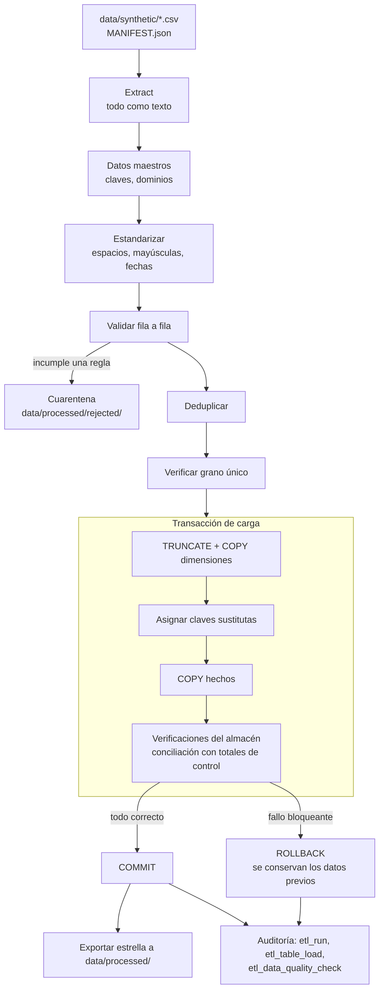

# Pipeline ETL

El pipeline convierte los extractos crudos en el modelo estrella cargado en PostgreSQL.
Código: [`pipelines/etl/`](../pipelines/etl/). Comando: `make etl`
(`python -m pipelines.etl`).

## 1. Flujo

## 2. Etapas

| Etapa | Módulo | Responsabilidad |
|-------|--------|-----------------|
| Extract | [`extract.py`](../pipelines/etl/extract.py) | Lee los CSV **como texto**, sin inferir tipos, y el manifiesto con los totales de control |
| Transform | [`transform.py`](../pipelines/etl/transform.py) | Estandariza, valida, deduplica, tipa y construye `dim_date` |
| Reglas | [`quality.py`](../pipelines/etl/quality.py) | Motor de reglas por fila y verificaciones de conjunto |
| Load | [`load.py`](../pipelines/etl/load.py) | Recarga completa con `COPY` y verificaciones posteriores a la carga |
| Orquestación | [`runner.py`](../pipelines/etl/runner.py) | Encadena las etapas, gestiona la transacción y registra la auditoría |

### Extract

Los archivos se leen con `dtype=str` y sin conversión de vacíos. Inferir tipos al leer
ocultaría problemas: un importe no numérico se convertiría en `NaN` en silencio. La
tipificación es responsabilidad explícita de la transformación.

### Transform

Cada extracto de hechos pasa por los mismos cuatro pasos:

1. **Estandarizar** defectos recuperables: espacios, mayúsculas en códigos y fechas en
   formato `DD/MM/AAAA`.
2. **Validar** fila a fila. Las reglas se evalúan en orden y cada fila inválida se atribuye
   a la primera regla que incumple, de modo que los conteos por regla suman el total
   rechazado.
3. **Deduplicar** duplicados exactos.
4. **Verificar el grano:** la clave de negocio debe ser única. Dos filas distintas con la
   misma clave no se pueden resolver de forma automática, así que la ejecución se detiene.

Los datos maestros se validan antes (claves únicas, campos completos, dominio de
`account_type`, un único nombre por código de categoría) porque son la referencia de las
reglas de integridad.

### Load

- **Recarga completa** (`TRUNCATE … RESTART IDENTITY` + `COPY`) dentro de una sola
  transacción. Con el volumen del proyecto tarda unos dos segundos, y evita la complejidad
  de una carga incremental que aquí no aporta nada.
- **Claves sustitutas** generadas por la base de datos. Como las dimensiones se insertan en
  el orden del archivo maestro y las secuencias se reinician, las claves son estables entre
  ejecuciones.
- **Verificaciones posteriores a la carga** dentro de la misma transacción. Si una regla
  bloqueante falla, la transacción se revierte y el almacén conserva su contenido anterior.

### Auditoría

El registro de la ejecución se escribe en una transacción aparte, de modo que las
ejecuciones fallidas también quedan registradas con su motivo.

## 3. Propiedades verificadas

| Propiedad | Cómo se comprueba |
|-----------|-------------------|
| **Recuperación exacta** | El ETL reconstruye exactamente el conjunto válido a partir de los extractos con defectos (`tests/etl/test_transform.py`) |
| **Conciliación** | Los totales cargados coinciden al centavo con los totales de control del manifiesto |
| **Idempotencia** | Ejecutar el pipeline dos veces deja el almacén idéntico, incluidas las claves sustitutas |
| **Atomicidad** | Una fuente que no concilia deja la ejecución en `FAILED` y los datos previos intactos |
| **Balance de filas** | `leídas = rechazadas + deduplicadas + cargadas` en cada extracto |

## 4. Resultado de la ejecución de referencia

Con la semilla del proyecto (`20230101`):

| Extracto | Leídas | Estandarizadas | Rechazadas | Duplicadas | Cargadas |
|----------|-------:|---------------:|-----------:|-----------:|---------:|
| `sales_transactions` | 109 825 | 25 | 26 | 40 | 109 759 |
| `expense_ledger` | 11 189 | 9 | 15 | 15 | 11 159 |
| `budget_plan` | 1 875 | 0 | 0 | 3 | 1 872 |

Se evalúan 54 reglas: 44 `PASS` y 10 `WARN`. Los `WARN` corresponden exactamente a los
defectos inyectados por el generador ([DATA_GENERATION.md](DATA_GENERATION.md), sección 6).

## 5. Salidas

| Destino | Contenido |
|---------|-----------|
| PostgreSQL | Dimensiones, hechos y tablas de auditoría |
| `data/processed/dim_*.csv`, `fact_*.csv` | El modelo estrella con claves sustitutas, para Power BI |
| `data/processed/rejected/*_rejected.csv` | Filas en cuarentena con la columna `reject_reason` |

## 6. Decisiones

- **pandas y no un motor distribuido:** 10⁵ filas caben holgadamente en memoria.
- **Reglas en código y no en un marco de validación externo:** unas veinte reglas simples no
  justifican otra dependencia; el motor propio ocupa menos de 200 líneas y está probado.
- **`COPY` y no `INSERT` por lotes:** es la vía de carga masiva nativa de PostgreSQL.
- **Sin orquestador:** hay una única tarea secuencial; `make pipeline` basta.
