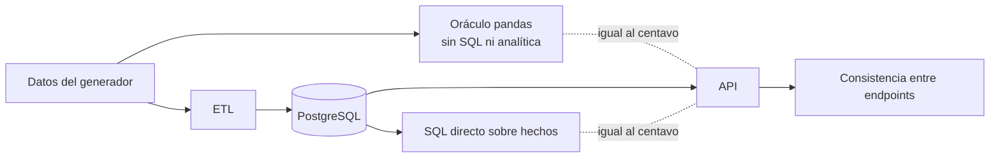

# Pruebas

## 1. Resultado de la última ejecución completa

`make ci` (`scripts/ci_local.sh`), ejecutado en local el 2026-11-12:

| Verificación | Herramienta | Resultado |
|--------------|-------------|-----------|
| Estilo y errores comunes (Python) | Ruff | Sin incidencias |
| Formato (Python) | Ruff format | Sin diferencias |
| Tipos (Python) | mypy `--strict` | Sin errores en 55 archivos |
| Pruebas de Python | Pytest | **250 de 250** |
| Cobertura de `backend` y `pipelines` | pytest-cov | **95 %** (líneas y ramas) |
| Validación SQL independiente | 16 consultas | **16 de 16** sin violaciones |
| Estilo y accesibilidad estática (web) | oxlint | Sin incidencias |
| Tipos (web) | TypeScript `strict` | Sin errores |
| Pruebas unitarias y de componentes | Vitest + Testing Library | **73 de 73** |
| Compilación de producción | Vite | Correcta |
| Pruebas de extremo a extremo | Playwright (Chromium) | **43 de 43** |

Lo que la cobertura no alcanza: los tres puntos de entrada de línea de comandos
(`python -m pipelines.generate`, `.etl` y `.evaluation`), que se ejecutan en el propio
`make ci` pero no dentro de Pytest, y la rama de la API para una base de datos caída.

**Instalación desde cero.** El mismo día se clonó el repositorio en un directorio vacío y
se siguieron los pasos del README (`make setup`, `make db-init`, `make pipeline`). La API
arrancó, las 16 consultas de validación y las 250 pruebas de Python pasaron, la aplicación
web compiló y sus 73 pruebas pasaron. Los ingresos netos de 2025 resultaron idénticos al
centavo a los del entorno de desarrollo (59 053 741,75 USD), lo que confirma que los datos
se reproducen en una instalación nueva. Las pruebas de extremo a extremo no se repitieron
en el clon.

**Docker Compose.** El mismo día, con Docker Desktop 29 (Compose v5) en macOS,
`docker compose up --build` construyó las tres imágenes (API y pipeline, 723 MB; web con
nginx, 78 MB) y levantó los cuatro servicios a la primera, sin cambios en los archivos. Se
comprobó:

| Comprobación | Resultado |
|--------------|-----------|
| Pipeline en contenedor: generación, migración y carga | `ETL run 1: SUCCESS`, 109 759 / 11 159 / 1 872 filas, 44 PASS y 10 WARN, igual que en nativo |
| 16 consultas de validación contra la base de datos del contenedor | 16 de 16 sin violaciones |
| Seis endpoints comparados con la API nativa (KPI, estado de resultados, atípicos, rentabilidad, precio-volumen-mezcla, calidad) | Respuestas idénticas; en `data-quality` solo difiere el historial de ejecuciones, como corresponde |
| Playwright contra `http://localhost:8080` (nginx sirve la web y reenvía `/api`) | **43 de 43** |
| `docker compose down` y `up` sobre el mismo volumen | El pipeline recarga el almacén (`ETL run 2`) y conserva la auditoría; arranque en 22 s |

**No verificado:** el flujo de GitHub Actions no se ha ejecutado (repositorio sin
publicar). Las pruebas de extremo a extremo solo se han ejecutado en Chromium, y Docker
Compose solo en macOS.

## 2. Cómo ejecutarlas

```bash
make ci                        # todo lo anterior
SKIP_E2E=1 make ci             # sin las pruebas de navegador

make test-unit                 # Python, sin base de datos (141 pruebas)
make test-integration          # Python, contra PostgreSQL (109 pruebas)
make test                      # Python completo, con cobertura
make validate                  # consultas SQL de validación
make test-web                  # Vitest
make e2e                       # Playwright; arranca la API y la web si no están en marcha
make lint && make typecheck

docker compose up --build -d   # la misma pila en contenedores, en http://localhost:8080
make e2e-docker                # Playwright contra esa pila (E2E_WEB_URL y E2E_API_URL)
docker compose down            # añade -v para borrar también el volumen de datos
```

Requisitos: `make setup`, `make db-init` y, para las pruebas de extremo a extremo,
`make pipeline` y `npx --prefix frontend playwright install chromium`.

Las pruebas de integración usan una base de datos propia (`POSTGRES_TEST_DB`). La
migran con Alembic y la cargan con el pipeline real una vez por sesión, de modo que
ejercitan el mismo camino que los datos de la aplicación.

## 3. Estrategia

La pregunta central de una plataforma financiera es si los números son correctos. Cada
indicador se comprueba por **tres caminos que no comparten código**:



1. **Oráculo.** Recalcula ingresos, costos, gastos, utilidades y márgenes con pandas sobre
   los datos del generador, sin pasar por la base de datos ni por el módulo analítico.
2. **SQL directo** sobre las tablas de hechos, sin las vistas.
3. **Consistencia interna:** las unidades de negocio suman el total, la serie mensual suma
   el KPI, los impactos de las 13 cuentas suman la variación de la utilidad operativa, y el
   CSV exportado suma lo mismo que la respuesta JSON.

Que los tres coincidan es evidencia de que la cifra es correcta, no de que un mismo error
se copió.

## 4. Qué cubre cada conjunto

### Python — 250 pruebas

| Conjunto | Pruebas | Qué demuestra |
|----------|--------:|---------------|
| `tests/generate` | 24 | La misma semilla produce archivos idénticos; el manifiesto versionado coincide con datos regenerados; identidades contables al centavo; márgenes plausibles; cada escenario deja la huella documentada |
| `tests/etl` | 23 | El ETL reconstruye **exactamente** el conjunto válido a partir de extractos con defectos; cada regla aparta lo que debe; los defectos recuperables se reparan; una clave en conflicto o un rechazo masivo detienen la carga |
| `tests/analytics` | 92 | Fórmulas y favorabilidad; periodos de comparación; precio-volumen-mezcla y mezcla-tasa suman el cambio total sobre 25 conjuntos aleatorios cada una, con productos que aparecen y desaparecen; el puente suma sobre casos construidos; el detector de atípicos y su tasa de falsos positivos |
| `tests/api` | 70 | Triangulación de los KPI; todos los filtros; validación de parámetros; series y tasas de crecimiento; presupuesto; rentabilidad; gastos; análisis; hallazgos; paginación, orden y filtro; CSV; documentación OpenAPI; almacén vacío |
| `tests/integration` | 41 | Carga completa, conciliación, idempotencia, reversión ante un fallo, auditoría; cada restricción de la base de datos rechaza lo que debe; las 16 consultas de validación; la evaluación publicada y los valores esperados de Power BI son reproducibles |

Pruebas que protegen afirmaciones de la documentación:

- `test_committed_manifest_matches_regenerated_data`: los datos son reproducibles.
- `test_published_evaluation_matches_a_fresh_run`: las cifras de la evaluación del detector
  son las que produce el código.
- `test_published_expected_values_match_a_fresh_calculation`: los valores esperados de
  Power BI están al día.
- `test_kpi_catalog_document_covers_every_kpi_in_code`: el catálogo documentado está
  completo.
- `test_false_positive_rate_on_pure_noise_is_known_and_bounded`: la tasa de falsos
  positivos declarada es real.

### Web — 73 pruebas unitarias y de componentes

| Archivo | Qué demuestra |
|---------|---------------|
| `format.test.ts` | Formato de moneda, porcentajes y puntos; los valores ausentes nunca se muestran como `NaN` |
| `api.test.ts` | Parámetros repetidos; el mensaje de error de la API llega al usuario; API inalcanzable |
| `filters.test.tsx` | Preajustes de periodo; una URL inválida vuelve a la selección por defecto |
| `options.test.ts` | Posición de las barras de la cascada, incluidas las que cruzan el cero; un solo eje; el color sigue a la entidad |
| `common.test.tsx` | Dirección y favorabilidad independientes; "No data" en lugar de una comparación inventada; orden de tablas y `aria-sort`; teclado; estados de carga, vacío y error |
| `Overview.test.tsx` | Los filtros llegan a **todos** los endpoints; al elegir una unidad se recalculan los KPI |

### Extremo a extremo — 43 pruebas

Se ejecutan en un navegador real contra la API real y los datos sembrados. Como la semilla
es fija, las cifras se afirman literalmente (por ejemplo, ingresos netos de 2025:
"$59.1M").

| Área | Qué demuestra |
|------|---------------|
| Overview | Cifras titulares, todos los bloques con datos, cambio de métrica, gráfico como tabla |
| Filtros globales | Una unidad recalcula KPI, gráficos, tablas y hallazgos; varias unidades suman; periodos; primer año sin comparación; base de comparación; rango personalizado; persistencia al navegar y recargar; URL inválida |
| Tabla analítica | Orden y paginación en el servidor; filtro por cumplimiento; descarga del CSV y su contenido |
| Resiliencia | Un endpoint caído muestra el error solo en su panel y se puede reintentar; API inalcanzable |
| Las ocho vistas | Cargan sin errores de consola; auditoría `axe-core` WCAG 2 A y AA sin incumplimientos graves ni críticos |
| Análisis | Precio, volumen y mezcla suman el cambio; filtro por categoría; estado de resultados del escenario de Wholesale; atípicos; calidad de datos; catálogo de KPI |
| Teclado y teléfono | Salto al contenido y filtros con teclado; sin desbordamiento horizontal a 390 px; navegación desplegable |

## 5. Defectos que encontraron las pruebas

| Defecto | Cómo se encontró |
|---------|------------------|
| Dos pruebas del detector asumían que el ruido gaussiano nunca supera el umbral; con 36 puntos lo supera en cerca del 9 % de las series | Fallo en la primera ejecución; ahora es una propiedad documentada y probada |
| Señales falsas en series casi constantes por el redondeo del presupuesto | Evaluación contra los escenarios |
| Al marcar dos unidades de negocio muy seguidas, la segunda borraba la primera | Playwright |
| Texto tenue con contraste inferior a 4,5:1; dos celdas de mapas de calor ilegibles | `axe-core` |
| Controles que ensanchaban la página en teléfono | Comprobación de desbordamiento |
| La barra de filtros se duplicaba en el DOM | Playwright (selector ambiguo) |

## 6. Límites

- Una sola semilla: no se prueba que los análisis se mantengan con otros datos.
- Sin pruebas de carga ni de concurrencia. Las pruebas de extremo a extremo usan dos
  procesos de navegador porque la API es un único proceso con trabajo ligado a CPU.
- Sin pruebas de regresión visual: la revisión visual se hizo sobre capturas, a mano.
- La accesibilidad se audita de forma automática; no se ha probado con lectores de
  pantalla.
- Un solo navegador (Chromium).
