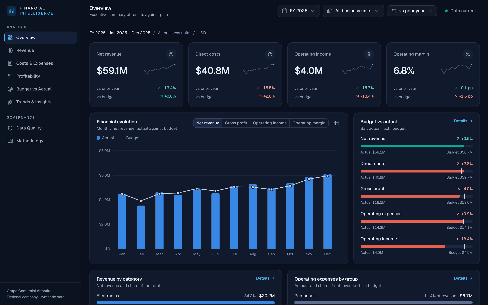
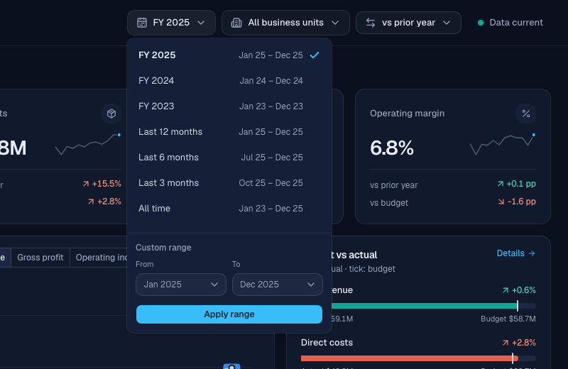
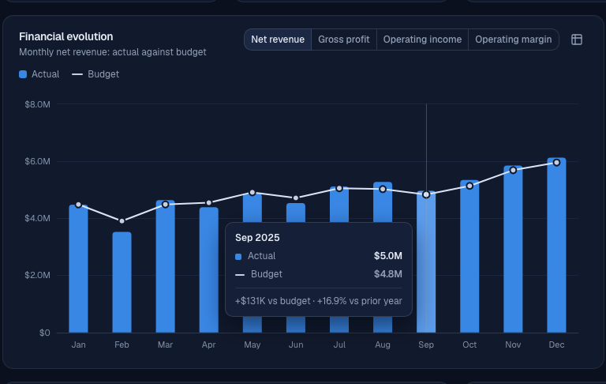
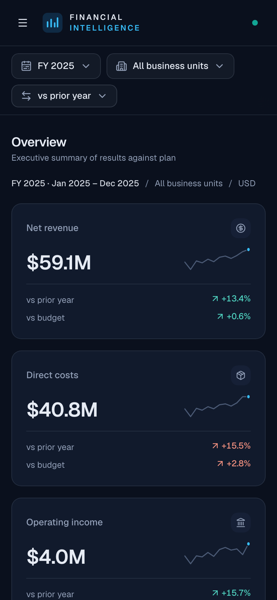
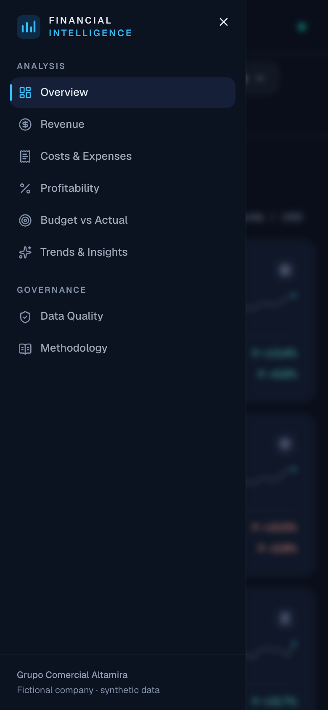

# Diseño de la interfaz

La interfaz es una aplicación React de una sola página conectada a la API. Este documento
recoge el sistema visual, las decisiones de visualización de datos y la evidencia de su
revisión. Las capturas son reales y se regeneran con `npm run screenshots`.



## 1. Principios

1. **El dato es lo único que puede llamar la atención.** Superficies, bordes y ejes son
   discretos; el color saturado se reserva para las marcas de datos y para el significado.
2. **Cada color tiene un único trabajo.** Un tono no significa una cosa en un gráfico y otra
   en el siguiente.
3. **Nada depende solo del color ni solo del cursor.** Toda cifra se puede leer sin pasar el
   ratón, y todo estado lleva icono y texto.
4. **Una sola fila de filtros gobierna toda la vista.** Indicadores, gráficos, tablas y
   hallazgos se recalculan con la misma selección.
5. **Ningún número se inventa en el cliente.** Todos los valores llegan de la API; la
   interfaz solo formatea.

## 2. Sistema visual

### Identidad

| Elemento | Decisión |
|----------|----------|
| Tema | Oscuro, único. No hay tema claro ([LIMITATIONS.md](LIMITATIONS.md)) |
| Tipografía | Geist Variable, servida con la aplicación (sin peticiones a terceros) |
| Cifras | Proporcionales en titulares; tabulares en tablas y ejes para alinear columnas |
| Iconografía | Lucide, trazo uniforme |
| Radios | 10 px en tarjetas; 4 px en el extremo de las barras |
| Movimiento | Transiciones de 200 a 350 ms; se anulan con `prefers-reduced-motion` |

### Superficies y tinta

| Rol | Valor | Uso |
|-----|-------|-----|
| Fondo | `#0a101d` | Plano de la página: azul marino profundo |
| Tarjeta | `#111a2c` | Superficie de paneles y gráficos |
| Elevado | `#16213a` | Tarjetas dentro de tarjetas, estados activos |
| Barra lateral | `#0b1220` | Navegación |
| Texto principal | `#e6ebf4` | Blanco suave, nunca blanco puro |
| Texto secundario | `#93a0b8` | Descripciones, etiquetas |
| Texto tenue | `#8391a9` | Códigos, notas; contraste ≥ 4,5:1 en todas las superficies |
| Acento | `#38bdf8` | Navegación activa, foco, enlaces |
| Borde | `rgb(148 163 184 / 0.14)` | Línea fina de separación |

### Color en los datos

Los colores de los gráficos no se eligieron a ojo. Cada conjunto se validó con un script
que mide, sobre la superficie real (`#111a2c`), la banda de luminosidad, el croma mínimo, el
contraste y la separación entre colores vecinos, tanto con visión normal como simulando
protanopia y deuteranopia. La distancia es ΔE en OKLab × 100; el objetivo es ≥ 8 con
daltonismo simulado y ≥ 15 con visión normal.

| Trabajo | Colores | Resultado de la validación |
|---------|---------|----------------------------|
| **Serie única** (magnitud) | `#3987e5` | Contraste 4,78:1 |
| **Referencia** (presupuesto, comparación) | `#c7d0e0`, `#66748c` | Neutros: se leen como contexto, no como dato |
| **Polaridad** (favorable / desfavorable) | `#12a594` / `#e5604d` | ΔE 11,2 con deuteranopia; 27,5 con visión normal |
| **Identidad** de las unidades de negocio | `#3987e5`, `#c98500`, `#d55181`, `#9085e9` | Vecinos: ΔE 13,2 con deuteranopia; 19,3 con visión normal |
| **Dos líneas** en un mismo gráfico | `#3987e5`, `#c98500` | ΔE 27,4 con protanopia |
| **Secuencial** (mapa de calor) | Rampa de un solo tono, `#15233d` → `#3987e5` | Tono único, luminosidad monótona |
| **Divergente** (variaciones) | Coral ← neutro `#1c2842` → verde azulado | Dos tonos opuestos y punto medio neutro |

Tres decisiones salieron directamente de esa validación:

- **No se usa el par verde-rojo convencional.** El verde y el rojo habituales quedan a ΔE
  4,1 con deuteranopia: indistinguibles para una parte de los lectores. El par verde azulado
  y coral conserva la lectura de "bien / mal" y sí se distingue.
- **Los verdes y los rojos nunca identifican una serie.** Así, cuando aparecen, siempre
  significan favorable o desfavorable.
- **Cuatro colores de unidad solo donde los vecinos son los únicos que se tocan.** En barras
  apiladas, cada color solo limita con el siguiente y la paleta pasa. En un gráfico de
  líneas que se cruzan cualquier par puede quedar junto, y ninguna combinación de cuatro
  tonos supera la prueba (azul y violeta quedan a ΔE 1,9 con protanopia). Por eso el margen
  por unidad se muestra como **múltiplos pequeños** de un solo color, con el nombre de la
  unidad como título de cada panel.

El color sigue a la entidad, no a su posición: Retail Stores es azul aunque un filtro lo
deje solo o cambie su lugar en el orden.

## 3. Elección de cada forma

| Necesidad | Forma | Por qué |
|-----------|-------|---------|
| Una cifra con su tendencia | Tarjeta de indicador con minigráfico | Un gráfico de una barra no aporta nada |
| Evolución frente al plan | Columnas (ejecución) y línea (presupuesto) en **un solo eje** | Dos tipos de marca: la identidad no depende del color |
| Composición en el tiempo | Columnas apiladas | El eje lleva los valores; cada unidad conserva su color |
| Comparar partes | Barras horizontales ordenadas, un solo tono | Una línea base común compara mejor que sectores de un círculo |
| Real frente a meta | Barra con marca de presupuesto | La distancia a la marca es la desviación |
| Cambio entre dos totales | Cascada | Los pasos suman exactamente la variación |
| Efectos pequeños sobre un total grande | Barras divergentes sobre cero | Ver "Revisión visual" |
| Variación mensual | Columnas con signo, color por favorabilidad | El signo dice la dirección; el color, si es buena o mala |
| Matriz de dos dimensiones | Tabla con celdas coloreadas y valor impreso | Es legible sin color y accesible por construcción |
| Cuatro series que se cruzan | Múltiplos pequeños en la misma escala | Ver sección 2 |

**No hay gráficos de doble eje.** Dos escalas en un mismo gráfico inventan una relación
visual que depende de cómo se alineen los ejes. Las medidas de distinta escala van en
gráficos separados o como razón sobre ingresos.

**No hay gráficos circulares.** Las comparaciones de participación se hacen con barras.

### Especificación de las marcas

- Columnas y barras de 24 px como máximo, con extremo redondeado de 4 px y base recta.
- Líneas de 2 px; marcadores de 8 px con anillo del color de la superficie.
- Separación de 2 px del color de la superficie entre segmentos apilados, en lugar de un
  borde.
- Rejilla y ejes en línea fina continua, un paso por encima de la superficie.
- El texto nunca lleva el color de la serie; la identidad la da una muestra de color junto
  a la etiqueta.

## 4. Interacción

- **Filtros globales:** periodo (años fiscales, últimos 12, 6 y 3 meses, todo el periodo y
  rango personalizado), unidades de negocio (selección múltiple) y base de comparación. En
  *Data Quality* y *Methodology* no se muestran porque no aplican.
- **La URL es el estado.** `?from=2024-04&to=2024-06&bu=WHS&cmp=pp` reproduce la vista
  exacta. Los filtros sobreviven a la navegación y a la recarga, y un valor inválido en la
  URL vuelve a la selección por defecto.
- **Sin parpadeo al refiltrar.** Mientras llega la nueva selección, el contenido anterior
  permanece atenuado; no hay esqueletos intermedios ni saltos de diseño.
- **Información emergente** en los gráficos de series: una línea vertical localiza el mes y
  el recuadro lista todas las series, con la desviación frente al presupuesto.
- **Vista de tabla** en cada gráfico: un botón lo alterna con sus datos.
- **Evidencia de cada hallazgo:** cada frase del panel se despliega para mostrar las cifras
  exactas de las que sale.
- **Exportación CSV** con los filtros vigentes en las tablas de detalle.
- **Estados:** carga (esqueleto solo en la primera carga), vacío (qué cambiar para ver
  datos), error (mensaje de la API y botón de reintento, limitado al panel afectado) y sin
  comparación (se explica por qué no hay cifra en lugar de mostrar un cero).





## 5. Diseño adaptable

| Ancho | Comportamiento |
|-------|----------------|
| ≥ 1280 px | Barra lateral fija; filtros en la barra superior; rejillas de 2 y 3 columnas |
| 1024–1279 px | Barra lateral fija; los filtros pasan a una segunda fila |
| < 1024 px | La navegación se convierte en un panel lateral desplegable |
| < 640 px | Una columna; las tablas anchas se desplazan dentro de su tarjeta |

Una prueba automatizada recorre las ocho vistas a 390 px y comprueba que la página no se
desborda en horizontal.

| Teléfono | Navegación |
|----------|------------|
|  |  |

## 6. Accesibilidad

- Estructura semántica: regiones con nombre, un único `h1` por vista, tablas con
  encabezados de fila y de columna, y enlace para saltar al contenido.
- Todo es operable con teclado: los controles son primitivas de Radix; los encabezados
  ordenables son botones con `aria-sort`.
- Foco visible en todos los elementos interactivos.
- Los gráficos tienen nombre accesible y una tabla equivalente.
- Favorable y desfavorable se expresan con flecha, signo, color y texto para lectores de
  pantalla.
- **Auditoría automática:** `axe-core` analiza las ocho vistas con las reglas WCAG 2 A y AA
  dentro de las pruebas de extremo a extremo. Resultado: **cero incumplimientos graves o
  críticos**.

La auditoría encontró defectos reales que se corrigieron: el texto tenue original
(`#66748c`) tenía un contraste de entre 3,1:1 y 4,0:1 según la superficie, por debajo del
4,5:1 exigido, y dos celdas de mapas de calor quedaban por debajo con texto blanco. Ahora el
texto tenue es `#8391a9` y la tinta de cada celda se elige según su fondo.

**Límites de esta verificación.** Una auditoría automática detecta solo una parte de los
problemas de accesibilidad. No se ha probado con lectores de pantalla reales ni con
usuarios.

## 7. Revisión visual

La interfaz se revisó sobre capturas de la aplicación en ejecución, no sobre el código.
Defectos encontrados y su corrección:

| Defecto observado | Corrección |
|-------------------|------------|
| "$4M" junto a "$59.1M": precisión desigual en una misma fila | Los millones conservan siempre un decimal ("$4.0M") |
| "+$55.4K" y "+$5,459" en una misma columna | Las columnas de tabla usan el importe completo |
| La tabla mensual se cortaba a dos tercios de ancho | Pasa a ancho completo |
| Tarjetas con espacio vacío junto a otras más altas | Las filas se reparten en la altura disponible |
| Hallazgos en una columna alta y estrecha | Cuadrícula de tres columnas |
| Cascada de precio, volumen y mezcla: con el eje desde cero, efectos de 5 M sobre un total de 52 M eran láminas ilegibles | Barras divergentes solo con los tres efectos, sobre una misma línea de cero |
| Mapa de calor de gastos cortado: faltaban tres columnas | Matriz transpuesta |
| El mapa de variaciones teñía de "desfavorable" diferencias de +0,8 % | Las variaciones menores de 1,5 % quedan neutras |
| Ejes irregulares en los múltiplos pequeños | Intervalo fijo de 10 puntos |
| Tablas con desplazamiento interno que cortaba una fila | Vista previa con botón "Show all" |
| Controles segmentados que ensanchaban la página en teléfono | Se desplazan dentro de su contenedor |

Las pruebas de extremo a extremo detectaron además un fallo funcional: al marcar dos
unidades de negocio muy seguidas, la segunda selección sobrescribía la primera porque
partía del estado ya renderizado y no del último solicitado. Está corregido.

## 8. Vistas

| Vista | Pregunta que responde | Captura |
|-------|----------------------|---------|
| Overview | ¿Cómo vamos frente al plan? | [overview.png](screenshots/overview.png) |
| Revenue | ¿De dónde vienen las ventas y qué las movió? | [revenue.png](screenshots/revenue.png) |
| Costs & Expenses | ¿En qué se gasta y cómo se comporta el gasto? | [costs.png](screenshots/costs.png) |
| Profitability | ¿Dónde está el margen y por qué cambió? | [profitability.png](screenshots/profitability.png) |
| Budget vs Actual | ¿Qué líneas explican la desviación? | [budget.png](screenshots/budget.png) |
| Trends & Insights | ¿Qué meses son inusuales? | [trends.png](screenshots/trends.png) |
| Data Quality | ¿Se puede confiar en los datos cargados? | [data-quality.png](screenshots/data-quality.png) |
| Methodology | ¿Cómo se define y se calcula cada cifra? | [methodology.png](screenshots/methodology.png) |

Vista filtrada (E-commerce, año fiscal 2024):
[overview-filtered.png](screenshots/overview-filtered.png).

## 9. Estructura del código

```
frontend/src/
  lib/           formato, cliente de API tipado, filtros (URL), consultas, tema de gráficos
  components/
    ui/          componentes shadcn/ui (Radix + Tailwind)
    common/      paneles, tarjetas de indicador, tablas, barras, estados, hallazgos
    charts/      contenedor de ECharts y constructores de opciones
    layout/      estructura de la aplicación, navegación y filtros
  pages/         una vista por archivo
frontend/e2e/    pruebas de extremo a extremo y captura de pantallas
```

Los tipos de las respuestas se generan desde el esquema OpenAPI del backend
(`npm run gen:api`), de modo que el cliente no puede divergir del contrato del servidor.
